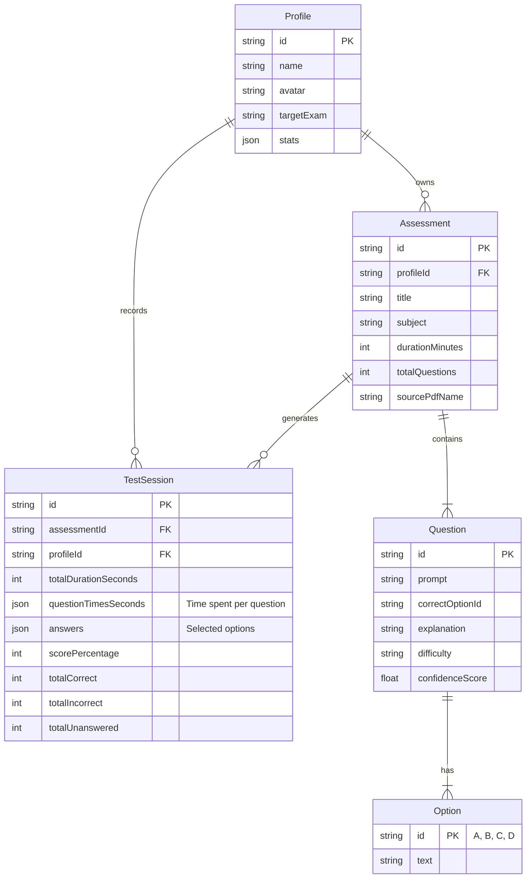
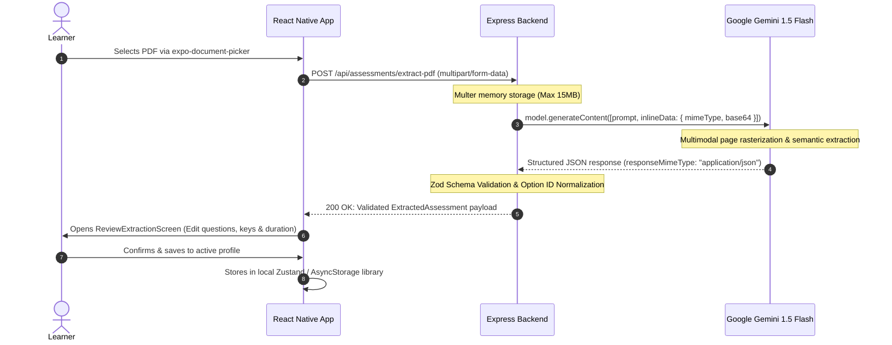

# Gemini Assessment Studio 🚀
### Intelligent Mobile Assessment Platform powered by Google Gemini & React Native

A cross-platform React Native mobile application and secure Node.js backend for generating, reviewing, taking, and analyzing assessments from uploaded PDF documents.

---

## 📑 Table of Contents
1. [Architectural Overview & Technology Choices](#architectural-overview--technology-choices)
2. [Project Structure](#project-structure)
3. [Domain Data Model](#domain-data-model)
4. [Secure PDF-to-Gemini Workflow](#secure-pdf-to-gemini-workflow)
5. [Quickstart & Setup Instructions](#quickstart--setup-instructions)
6. [Core Screen Guide & Features](#core-screen-guide--features)
7. [Security & Production Hardening](#security--production-hardening)
8. [Accessibility & UX Details](#accessibility--ux-details)
9. [Testing Guide](#testing-guide)

---

## 1. Architectural Overview & Technology Choices

### Recommended Libraries & Rationale

| Layer | Technology | Rationale & Tradeoffs |
|---|---|---|
| **Mobile Framework** | **React Native (Expo SDK 52)** | Modern cross-platform architecture with TypeScript, native screen animations, and robust development ergonomics. |
| **Navigation** | **React Navigation Native Stack v7** | Hardware-accelerated transitions via `react-native-screens`, native header feel, gesture control, and strictly typed stack parameters. |
| **PDF Selection** | **`expo-document-picker`** | Native sandboxed file picker on iOS and Android with MIME validation (`application/pdf`) and memory-safe cache copying. |
| **State Management** | **Zustand v5** | Extremely lightweight (<2KB), zero Context-provider re-render storms, fine-grained selector subscriptions, and built-in asynchronous persist middleware. |
| **Local Storage** | **`AsyncStorage` / MMKV compatible** | Battle-tested key-value persistence for learner profiles, test library, and historical assessment session metrics. |
| **Backend & AI** | **Node.js + Express + `@google/generative-ai`** | Secure API gateway preventing Gemini API key leakage to mobile clients; parses PDFs multimodally and enforces strict Zod schema validation. |

---

## 2. Project Structure

```
"Google Gemini App"/
├── backend/                        # Secure Node.js Express API
│   ├── .env.example                # Environment variables template
│   ├── .env                        # Local configuration
│   ├── package.json
│   ├── tsconfig.json
│   ├── src/
│   │   ├── index.ts                # Express server, multer & error middleware
│   │   ├── geminiService.ts        # Google Generative AI integration & mock fallback
│   │   ├── validation.ts           # Zod schema validation & option normalizer
│   │   └── types.ts                # Backend TypeScript interfaces
│   └── test/
│       └── validation.test.ts      # Node test runner validation suite
│
├── mobile/                         # React Native (Expo) Mobile App
│   ├── app.json                    # Expo project configuration
│   ├── package.json
│   ├── tsconfig.json
│   ├── index.js                    # Application root entry
│   ├── App.tsx                     # React Navigation Native Stack setup
│   └── src/
│       ├── types/
│       │   ├── index.ts            # Domain models (Profile, Assessment, Session)
│       │   └── navigation.ts       # Typed React Navigation param lists
│       ├── constants/
│       │   ├── theme.ts            # Slate & Indigo design tokens and typography
│       │   └── mockData.ts         # Preloaded starter profiles & multi-subject tests
│       ├── store/
│       │   ├── useAssessmentStore.ts # Persisted store (Profiles, Tests, Sessions)
│       │   └── useTestExecutionStore.ts # Active test runtime (Timers, Answers, Palette)
│       ├── services/
│       │   ├── api.ts              # Multipart file upload to backend
│       │   └── storage.ts          # Storage helpers
│       ├── components/
│       │   ├── Button.tsx          # Accessible buttons with states & loading
│       │   ├── Card.tsx            # Elevated slate container
│       │   ├── Header.tsx          # Screen header with title & back button
│       │   ├── TimerBadge.tsx      # Dual timer badge with warning states
│       │   ├── QuestionPaletteModal.tsx # Full question jump palette
│       │   ├── SubmitConfirmationModal.tsx # Unanswered question warning dialog
│       │   └── LoadingOverlay.tsx  # Multi-phase AI extraction progress overlay
│       └── screens/
│           ├── LandingScreen.tsx   # Welcome hero, profile pill & quick CTAs
│           ├── ProfileScreen.tsx   # Switch & create profiles with avatar picker
│           ├── LibraryScreen.tsx   # Subject tabs, search, and assessment cards
│           ├── CreateAssessmentScreen.tsx # PDF picker, subject & backend URL setup
│           ├── ReviewExtractionScreen.tsx # Review/edit questions & keys before saving
│           ├── TestRunnerScreen.tsx # 1-at-a-time test player with dual timers
│           └── ResultsScreen.tsx   # Score gauge, filter tabs & detailed explanations
└── README.md
```

---

## 3. Domain Data Model



---

## 4. Secure PDF-to-Gemini Workflow

### Security Principle
**Google Gemini API credentials must NEVER be placed in mobile client code or bundles.** Reverse engineering mobile binaries (`.apk` or `.ipa`) reveals bundled environment variables. In this architecture:
1. The mobile client holds zero AI credentials.
2. The mobile client sends a multipart file upload to the trusted backend.
3. The backend authenticates to Gemini server-to-server.
4. The backend validates and sanitizes all generated JSON before responding.

### Extraction Flow



---

## 5. Quickstart & Setup Instructions

### Prerequisites
- Node.js >= 18 (Tested on Node v26)
- npm >= 9
- Google Gemini API Key from [Google AI Studio](https://aistudio.google.com/) (Optional: mock fallback is automatically provided for offline testing).

### Step 1: Start the Backend Server

```bash
cd backend
npm install

# Copy environment template
cp .env.example .env

# Edit .env and set your GEMINI_API_KEY:
# GEMINI_API_KEY=AIzaSy...

# Start backend in development mode (hot reload via tsx)
npm run dev
```

The backend starts at `http://localhost:4000`:
- **Health Check**: `http://localhost:4000/api/health`
- **PDF Extraction**: `POST http://localhost:4000/api/assessments/extract-pdf`

### Step 2: Start the React Native Mobile App

In a new terminal:
```bash
cd mobile
npm install

# Start Expo development server
npx expo start
```

Press:
- `i` to open in iOS Simulator (requires macOS + Xcode)
- `a` to open in Android Emulator (requires Android Studio)
- `w` to open in Web Browser for rapid visual testing
- Scan the QR code using the **Expo Go** app on your physical iOS/Android phone!

> **Note for Physical Devices:** When testing on a physical phone over Wi-Fi, update the backend URL on the **Create from PDF** screen from `localhost` to your computer's local Wi-Fi IP (e.g. `http://192.168.1.50:4000`).

---

## 6. Core Screen Guide & Features

### 1. Landing Screen (`LandingScreen.tsx`)
- Elegant dark slate/indigo hero branding.
- Shows current active profile badge with a 1-tap "Switch" action.
- Direct entry points: Assessment Library, PDF Creation Studio, Profile Management.

### 2. Profile Management (`ProfileScreen.tsx`)
- View multiple learner profiles (e.g. "Alex (STEM)", "Elena (Pre-Med)").
- Metrics tracking: Total tests taken, average score percentage, and study time.
- Interactive modal to add new profiles with 10 custom avatar emojis and target goals.

### 3. Assessment Library (`LibraryScreen.tsx`)
- Filter tests by subject tabs: **All**, **Computer Science**, **Mathematics**, **Biology**, etc.
- Live keyword search across assessment titles and topics.
- Card metrics: Question count, allocated minutes, average pace per question, and source PDF tag.
- One-tap "Start Assessment" and floating PDF creation CTA.

### 4. Create from PDF Screen (`CreateAssessmentScreen.tsx`)
- Native document picker (`expo-document-picker`) filtering for PDF files.
- Displays file size and name validation.
- Select target subject category.
- Animated multi-stage loading indicator (`LoadingOverlay.tsx`) showing real-time extraction progress.
- Comprehensive error banners for oversized files, unreadable PDFs, or network timeouts.

### 5. Review & Edit Extraction Screen (`ReviewExtractionScreen.tsx`)
- **Review before saving**: Inspect extracted title, subject, and time limit.
- Per-question AI confidence score indicator (e.g. 95% Confidence).
- Live inline editing of question prompts and answer option texts.
- Designate the correct option by tapping its radio badge (`A`, `B`, `C`, `D`).
- Delete invalid questions or manually add additional questions.
- Saves directly to the active profile's local storage.

### 6. Test Runner Screen (`TestRunnerScreen.tsx`)
- **1 question at a time**: Focused, distraction-free examination interface.
- **Dual Timers**:
  - `TimerBadge`: Tracks overall assessment elapsed time.
  - `Q-Pace Badge`: Tracks seconds spent specifically on the current question.
- **Answer Selection**: Accessible radio cards with clear selection states.
- **STRICT**: Correct answers are **never** revealed during the test.
- **Navigation**: Previous, Next, Flag for Review (🚩).
- **Question Palette Modal**: Visual grid showing Answered (Green), Flagged (Amber), and Unanswered (Slate) questions with instant jump navigation.
- **Submit Confirmation Modal**: Explicitly warns learners of unanswered questions before allowing final submission.

### 7. Results Screen (`ResultsScreen.tsx`)
- Circular score badge showing percentage, score ratio, and performance praise.
- Pacing analytics: Total time spent vs allocated, and average time per question.
- Filter review list by: **All**, **Correct**, **Incorrect**, **Left Blank**.
- Full question breakdown showing:
  - User's selected choice (with green tick or red cross).
  - True correct choice highlighted in emerald.
  - Time spent on that specific question.
  - Deep AI rationale and explanation provided by Gemini.
- "Retake Assessment" and "Return to Library" actions.

---

## 7. Security & Production Hardening

1. **Zero Client Secret Exposure**:
   - `GEMINI_API_KEY` exists exclusively in `backend/.env`.
   - Never referenced in mobile source files or build manifests.
2. **Buffer-Only Processing**:
   - Files are held in memory during the request lifecycle using Multer memory storage and immediately garbage-collected.
3. **Payload Sanitization**:
   - Request payloads are capped at 15MB.
   - MIME types are strictly verified (`application/pdf`).
4. **Resilient AI Parsing**:
   - Gemini JSON output is parsed and normalized by `Zod` schemas. If Gemini assigns an unexpected option key format (e.g., numbers `1, 2` instead of `A, B`), normalizers automatically re-map them safely.

---

## 8. Accessibility & UX Details

- **Touch Targets**: All interactive elements exceed 44x44 points.
- **ARIA & Screen Readers**: All buttons and option cards define `accessible={true}`, `accessibilityRole="button"` / `"radio"`, and dynamic `accessibilityLabel` attributes.
- **Visual Contrast**: Slate dark theme (`#0B0F19`) with high-contrast text (`#F8FAFC`) and WCAG-compliant status colors (Emerald `#10B981`, Amber `#F59E0B`, Crimson `#EF4444`).
- **Tabular Numerals**: Timers use `fontVariant: ['tabular-nums']` to prevent layout jitter as seconds tick.

---

## 9. Testing Guide

### Backend Tests
Run the automated test suite using Node's built-in test runner:
```bash
cd backend
npx tsx --test test/validation.test.ts
```

Tests cover:
- Normalization of irregular option keys.
- Fallback recovery when correct option keys are missing or ambiguous.
- Zod schema validation errors.
